# un-GPT LoRA for MOSS-Image

An edit LoRA that re-samples images from [MOSS-Image SFT](https://huggingface.co/OpenMOSS-Team/MOSS-Image-SFT) to reduce the glossy, GPT-style look: less sheen and blush, flatter shading, more defined line work. The character and composition stay mostly the same.

It works as a second pass. Generate with MOSS SFT as usual, then run the image through the LoRA with a fixed instruction. Loading the LoRA during normal text-to-image does nothing useful (see [Results](#results)).

| MOSS SFT | Re-sampled | Score (lower is less GPT-like) |
|---|---|---|
| 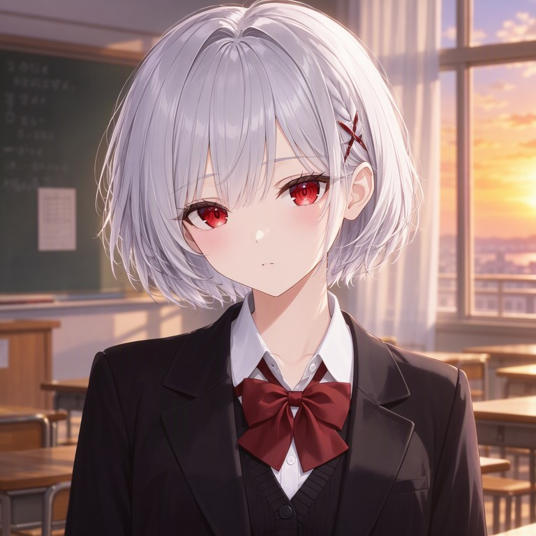 | 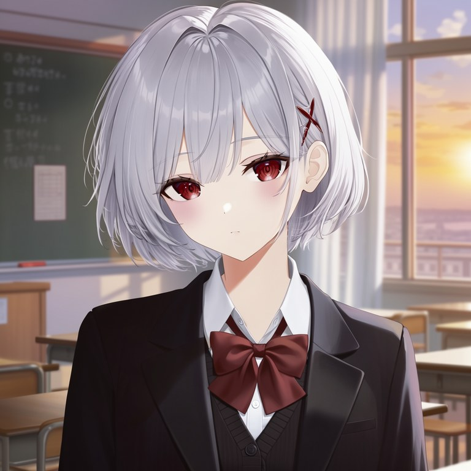 | 0.88 → 0.43 |
| 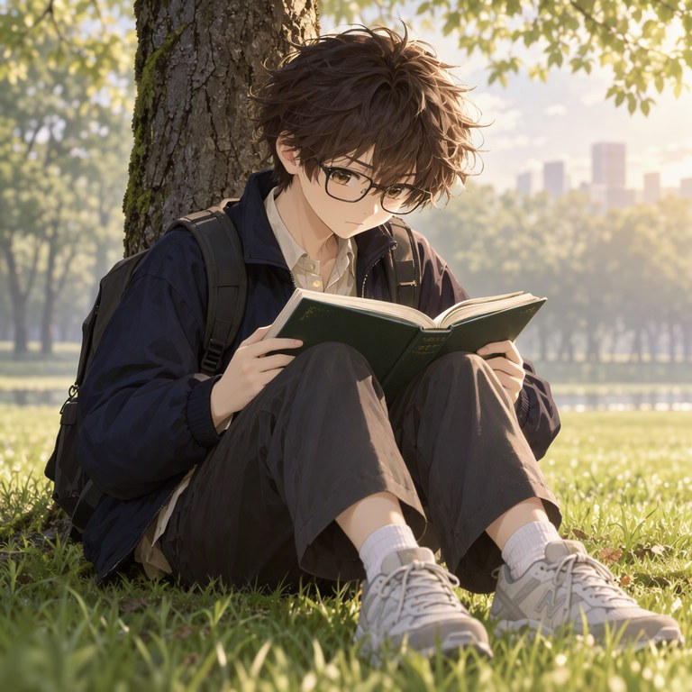 | 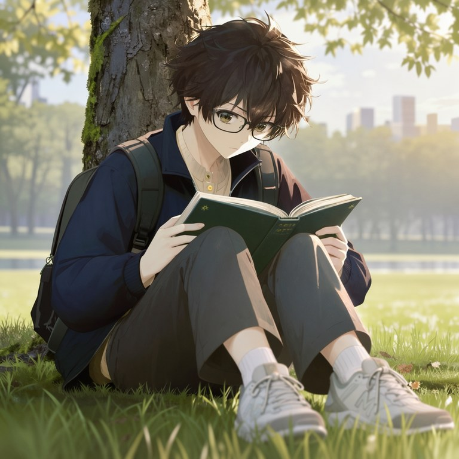 | 0.99 → 0.95 |
| 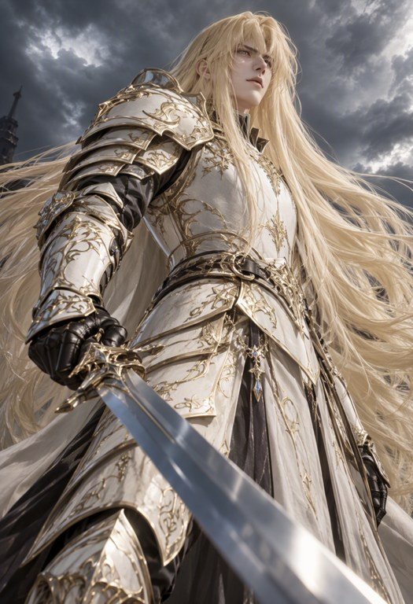 | 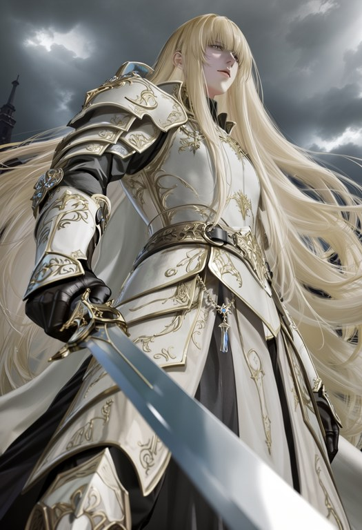 | 0.99 → 0.19 |
| 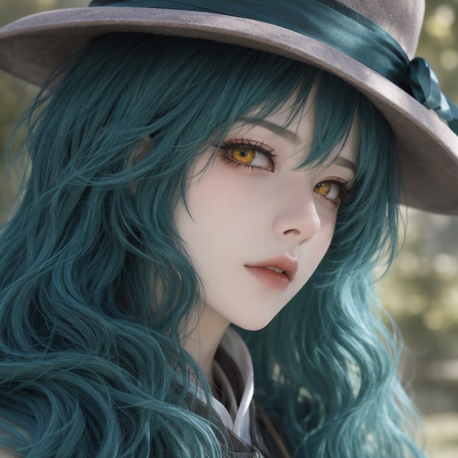 | 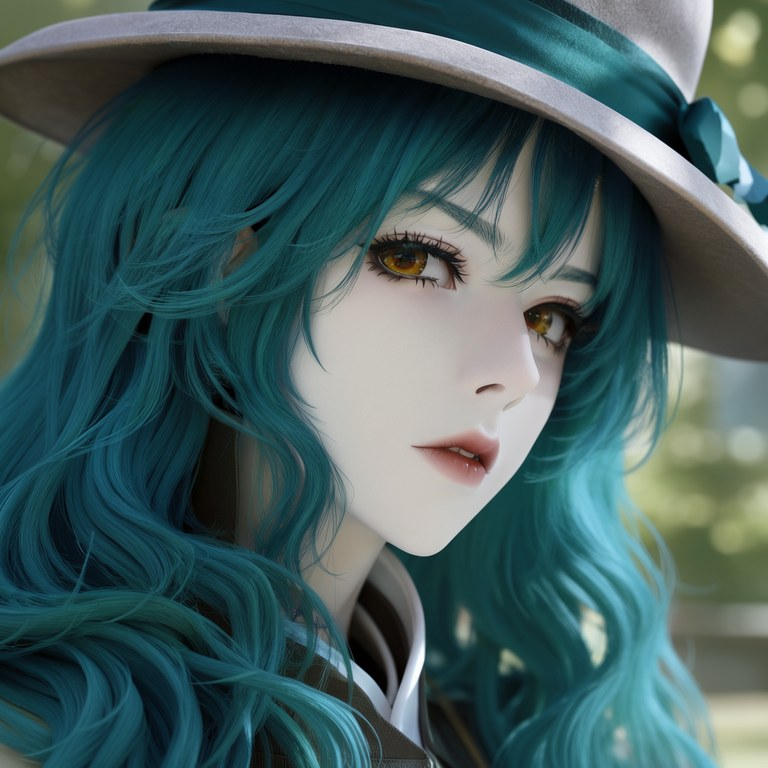 | 1.00 → 0.99 |
| 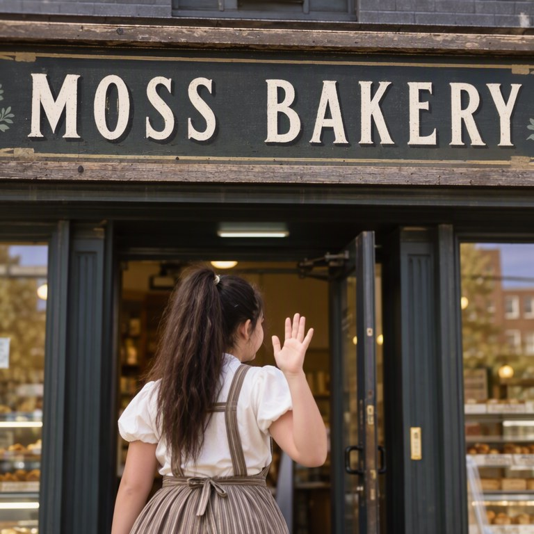 | 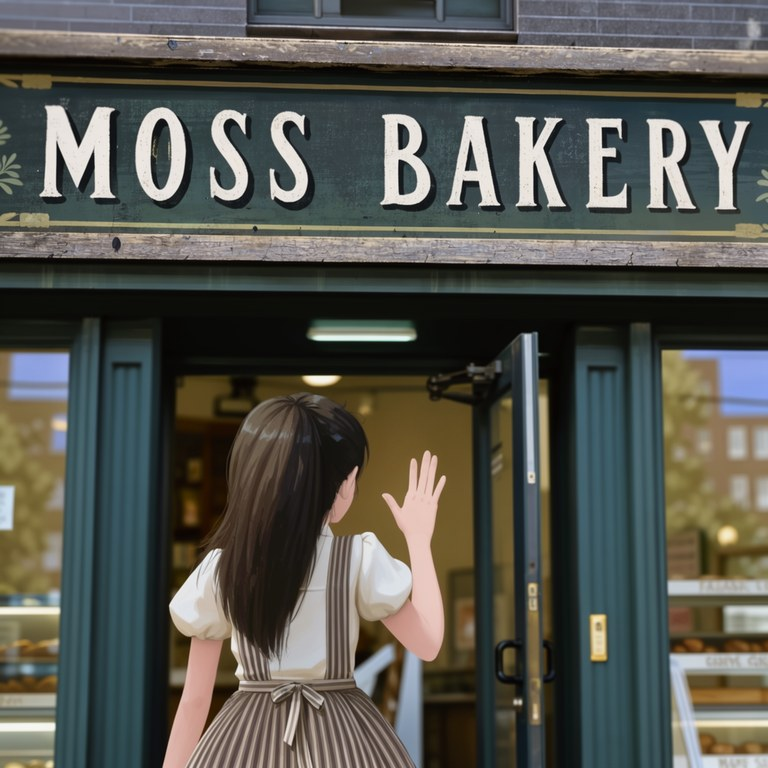 | Text prompt: 0.07 → 0.02 |
|  |  | Text prompt: 0.00 → 0.00 |
|  |  | Largest drop: 0.94 → 0.11 |
| 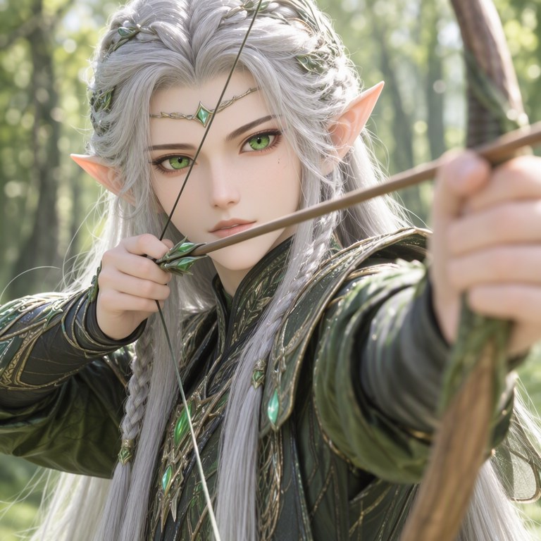 | 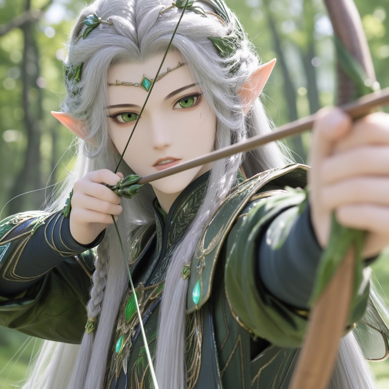 | Smallest drop: 1.00 → 1.00 |

These examples were picked by a fixed rule: the first four test prompts, the two text prompts, and the largest and smallest score drops.

## Use it in ComfyUI

No custom nodes are needed. Update ComfyUI to a current version that includes the **Text Encode MOSS-Image Edit** node.

**1. Download the models** into your ComfyUI `models` folder:

| File | Folder | Size |
|---|---|---|
| [moss_image_sft_bf16.safetensors](https://huggingface.co/Comfy-Org/MOSS-Image/resolve/main/diffusion_models/moss_image_sft_bf16.safetensors) | `diffusion_models/` | 10.2 GB |
| [qwen3.5_9b_bf16.safetensors](https://huggingface.co/Comfy-Org/MOSS-Image/resolve/main/text_encoders/qwen3.5_9b_bf16.safetensors) | `text_encoders/` | 19.3 GB |
| [flux2-vae.safetensors](https://huggingface.co/Comfy-Org/MOSS-Image/resolve/main/vae/flux2-vae.safetensors) | `vae/` | 336 MB |
| [ungpt_v1.safetensors](../../releases/latest) | `loras/` | 149 MB |

SHA-256 of `ungpt_v1.safetensors`: `053a2df9828ed32df0287da4429e55811ba92694c7cb5a35eb21f9b1a8d2aa26`

**2. Drag a workflow into ComfyUI:**

| Workflow | Use it when |
|---|---|
| [`moss_sft_t2i_then_ungpt.json`](workflows/moss_sft_t2i_then_ungpt.json) | You want to go from a prompt to a final image. It runs both passes in one queue and saves the before and after. |
| [`ungpt_resample_image.json`](workflows/ungpt_resample_image.json) | You already have a MOSS SFT image. Select it in Load Image, or copy [`example_moss_sft_output.png`](workflows/example_moss_sft_output.png) into ComfyUI's `input` folder to try the example. |

API-format versions for scripts are in [`workflows/api/`](workflows/api/). ComfyUI also loads those by drag and drop.

**3. Queue the prompt.** On an RTX PRO 6000, text-to-image took about 20 s and the re-sample about 46 s, with about 28 GB of VRAM in use. Smaller cards and the quantized model files were not tested.

### Settings to keep

The results below were measured with these settings, and the workflows already use them:

| Setting | Value |
|---|---|
| Instruction | `Redraw this image as hand-drawn anime art without the AI-generated look. Keep the character, pose, outfit and framing.` |
| Negative | Empty prompt, with the same image attached |
| Edit format | `ai-toolkit (kv_cache off)` |
| LoRA strength | 1.0 |
| Sampling | 50 steps, CFG 3, `euler`, `sgm_uniform`, denoise 1.0 |
| Guidance | Skip Layer Guidance DiT Simple, `single_layers` = 22, `double_layers` empty |
| Size | About 1 MP, sides in multiples of 16, output the same size as the input |

The re-sample starts from empty noise and is guided by the input image, so denoise stays at 1.0. It is not a low-denoise img2img pass.

## Results

Tested on 24 text-to-image prompts with one seed each. The score comes from a classifier on CLIP image embeddings that separates gpt-image-2 images from hand-drawn anime art. It was frozen before any LoRA output existed and reached AUC 0.99 on held-out images.

| MOSS SFT | Median score | Under 0.5 |
|---|---|---|
| Text-to-image, no LoRA | 0.927 | 3 of 24 |
| Text-to-image with the LoRA loaded | 0.909 | 5 of 24 |
| Re-sampled **without** the LoRA | 0.952 | 4 of 24 |
| **Re-sampled with the LoRA** | **0.452** | **13 of 24** |

- The re-sample lowered the score on all 24 images. Without the LoRA the same step had almost no effect.
- The same character was kept in 24 of 24 images (CCIP), and the pose in 22 of 23 where a pose could be detected (DWPose).
- The classifier never saw MOSS images in training, so treat its scores as a guide and judge the images yourself.

## Limits

- **The effect varies by image.** 13 of the 24 ended under 0.5, but on 4 the score moved by 0.04 or less. Compare the before and after on your own images.
- **Details can change.** Expect small changes to hair, faces and expressions. In the examples above, the bakery girl's ponytail and the poster character's face both changed. Check text in your output too: the two signs tested stayed readable, but that is a small sample.
- **It adds a look, not an artist.** It moves images toward a generic hand-drawn style and does not recover any specific artist's style.
- **gpt-image-2 input is less reliable.** On 36 gpt-image-2 test images the median score fell from 0.890 to 0.013, but the pose was kept in only 83%. Colour casts can get stronger, and framing and faces can drift more than on MOSS images.
- **Not tested:** the MOSS-Image Base model, more than one seed per prompt, other LoRA strengths or samplers, and input from other models.

Outputs are still AI-generated, so please label them that way. The score above is not an AI detector, and this LoRA has not been tested against one.

## Training

Trained with [ai-toolkit](https://github.com/ostris/ai-toolkit) on MOSS-Image SFT: 12,000 steps, rank 32, learning rate 5e-5 with cosine decay, EMA 0.999. Every other step was prior regularization on plain text-to-image, which is why plain text-to-image barely changes.

## License

The LoRA and workflows are released under [Apache-2.0](LICENSE), the same license as MOSS-Image. The license covers this release only, and makes no statement about rights in the training data.
